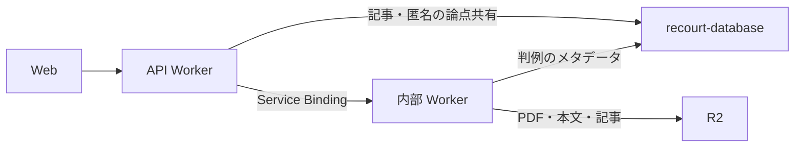

# 開発環境とDBマイグレーション

リポジトリが指定する Node.js 26 と pnpm を使用する。依存関係は `pnpm install --frozen-lockfile` でインストールする。

## ローカル開発

リポジトリのルートで次のコマンドを実行する。

```sh
pnpm db:migrate
pnpm dev
```

API (8787) と内部 Worker は、ルートの `.wrangler/state` にある同じローカル D1 を使う。Crawler (8788) の開発コマンドが External Service、Extract、Internal も起動する。Web のポートは 5137。

AI を使う場合は、`app/api/.dev.vars.example` と `app/extract/.dev.vars.example` を各ディレクトリの `.dev.vars` にコピーし、`VERCEL_AI_GATEWAY_API_KEY` を設定する。記事 URL の取込には Cloudflare の Browser Run も利用する。Web の接続先を変える場合は `app/web/.env.example` の `VITE_CASE_API_URL` を使う。 `VITE_` で始まる値はブラウザに公開される。



## マイグレーションの実行

D1 の SQL は `packages/database/d1-migrations` に置く。スキーマを変更したら次のコマンドで差分を生成し、ローカルに適用する。

```sh
pnpm --filter @recourt/database migrate:generate --name=change_name
pnpm db:migrate
```

Wrangler が `d1_migrations` の履歴を使って未適用の SQL を適用する。 `pnpm db:migrate:remote` は Wrangler の認証先にある `recourt-database` に適用する。GitHub Actions は内部 Worker のデプロイ前にこのコマンドを実行するため、CI の Cloudflare トークンには対象アカウントの D1 編集権限が必要。

CockroachDB の SQL 履歴は `packages/database/migrations` に保存している。旧環境からデータを引き継ぐ場合は、D1 にスキーマを適用してから行を取り込む。UUID と R2 のキーは維持し、タイムスタンプは Unix ミリ秒、JSONB は JSON 文字列、真偽値は `0` または `1` に変換する。判例の PDF や本文が入った R2 バケットも同じデータにそろえる。

## 初回の API 公開

1. `pnpm db:migrate:remote` でリモート D1 を初期化する。
2. [R2 の定義](../terraform/storage.tf)にある 3 つのバケットを用意し、`pnpm exec wrangler deploy --config app/internal/wrangler.jsonc` で内部 Worker をデプロイする。
3. API を初めて作成する場合は `VERCEL_AI_GATEWAY_API_KEY` を含むシークレット用ファイルを用意し、`pnpm exec wrangler deploy --config app/api/wrangler.jsonc --secrets-file <path>` を実行する。
4. `https://api.recourt-v1.tuki.dev` で CORS と `GET /api/topics` の応答を確認する。初回収集は [判例読解の導入手順](case-reading.md#導入)に従う。

## テスト

```sh
pnpm --filter @recourt/api test
pnpm --filter @recourt/internal test
pnpm --filter web test
```
