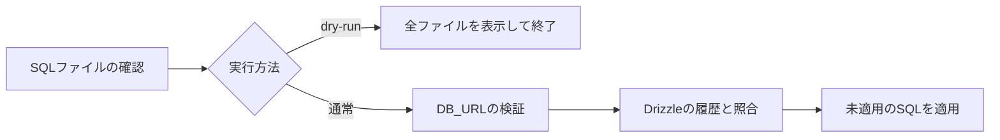

# 開発環境とDBマイグレーション

Node.js 24と、`package.json` に指定したpnpmを使用する。依存は `pnpm install --frozen-lockfile` でインストールする。データベースはCockroachDBを用意し、接続先の `recourt` データベースをあらかじめ作成する。

## 環境変数のサンプル

リポジトリルートで必要なサンプルをコピーし、接続先とキーを書き換える。既存の設定がある場合は上書きせず、必要な項目だけを追加する。

```sh
cp -n .env.example .env
cp -n app/api/.dev.vars.example app/api/.dev.vars
cp -n app/internal/.dev.vars.example app/internal/.dev.vars
cp -n app/extract/.dev.vars.example app/extract/.dev.vars
cp -n app/web/.env.example app/web/.env
```

| ファイル                           | 項目                                             | 用途                                           |
| ---------------------------------- | ------------------------------------------------ | ---------------------------------------------- |
| `.env`                             | `DB_URL`                                         | マイグレーションCLIの接続先                    |
| `app/api/.dev.vars`                | `DB_URL`, `VERCEL_AI_GATEWAY_API_KEY`            | 匿名論点共有・記事読解・AI解説                 |
| `app/internal/.dev.vars`           | `DB_URL`                                         | 判例・記事・読解文書の保存と取得               |
| `app/extract/.dev.vars`            | `VERCEL_AI_GATEWAY_API_KEY`                      | 判例分類と記事生成                             |
| `app/web/.env`                     | `VITE_CASE_API_URL`                              | 判例読解・論点共有のAPI接続先（任意）          |
| `app/renovate-scheduler/.dev.vars` | `GITHUB_APP_CLIENT_ID`, `GITHUB_APP_PRIVATE_KEY` | Renovateスケジューラーを個別に利用する場合のみ |

3か所の `DB_URL` は同じデータベースを指すように設定する。ルート `.env` はマイグレーションCLIが読み込み、Workerには各ディレクトリの `.dev.vars` を用意する。[Cloudflareのローカル環境変数の仕様](https://developers.cloudflare.com/workers/local-development/environment-variables/)に合わせ、Workerと同じディレクトリに配置する。

サンプルのDB接続は、ローカルのinsecureモードで動くCockroachDB向け。CloudのDBでは、証明書・TLSの指定を含めて提供された接続URLを使う。AI用のキーは `replace-with-...` を実際の値に置き換える。Webの `VITE_` 値はブラウザに公開されるため、DB接続URLやAIキーを置かない。

`WEB_ORIGIN` は `pnpm dev` が `http://localhost:5137` に設定する。R2・Queue・Workflow・Service Binding・レート制限は各 `wrangler.jsonc` の設定を利用するため、環境変数としてIDを追加する必要はない。CrawlerとExternal Serviceには現在必要なシークレットがない。

## マイグレーションの実行

```sh
# ファイル確認のみ。DBへ接続せず、全SQLファイルを一覧表示する。
pnpm db:migrate --dry-run

# .env のDB_URLへ接続し、未適用のマイグレーションを適用する。
pnpm db:migrate
```

`packages/database/scripts/migrate.mjs` はルート `.env` を読み込み、設定済みの環境変数を優先する。CI等で `DB_URL` を環境変数として渡す場合は `.env` を作成する必要はない。接続URLやキーはスクリプトの案内に表示しない。



適用はインストール済みの `drizzle-kit migrate` に委譲し、`packages/database/migrations` のSQLをDrizzleの履歴に従って適用する。履歴テーブルは標準の `drizzle.__drizzle_migrations` を利用し、適用済みのSQLは再実行しない。DBの作成、シークレット設定、Workerのデプロイはこのコマンドには含まない。

既存DBでSQLを手動適用しておりDrizzleの履歴がない場合は、自動では適用済みと判定できない。その状態で初期SQLを再実行せず、既存スキーマと履歴の移行を先に確認する。テーブルの存在だけでマイグレーションを自動的に適用済み扱いにはしない。

`--dry-run` はDBの適用状況を確認するものではなく、ローカルの全SQLファイルを確認する。新しいSQLを生成する既存コマンドは次のとおり。

```sh
pnpm --filter @recourt/database migrate:generate
```

## 起動と確認

DBへ適用したら `pnpm dev` を実行する。Webは5137、APIは8787、Crawlerは8788。CrawlerがExternal Service・Extract・Internalを同じ開発環境で起動するため、補助Workerを重複して起動しない。

```sh
pnpm --filter @recourt/database test:migrate
pnpm --filter @recourt/api test
pnpm --filter web test
```

固定の裁判官資料と端末内メモはDB・AIキーなしでも閲覧できる。匿名論点の保存・集計にはマイグレーション済みのDB、AI読解にはAIキー、裁判所からの収集には既存のパイプライン設定が必要。詳細は[判例読解](case-reading.md)と[裁判官の公開資料](judicial-review.md)を参照する。
