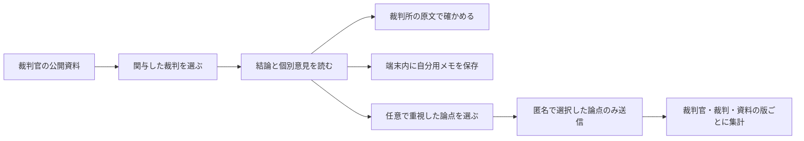

# 裁判官を知り、自分で考える

再考裁の入口を裁判官中心に変更した。トップページから、関与した裁判、その裁判での意見、裁判所の原文へ進める。既存のトピック検索・AI読解・記事URL読解は、トップページの「判例から読む」にある。

設計の根拠は、miloa の[プロジェクト記録](https://miloa.io/w/01kqcj19q83mdb6per8jx8p000/entries/01m6h93tcknrh3tv9zbj8a6j3s)、[法社会学についての議論](https://miloa.io/w/01kqcj19q83mdb6per8jx8p000/entries/01m6h6s8qjam9wts5bd6kf0c6g)、[11月6日の思想MTG](https://miloa.io/w/01kqcj19q83mdb6per8jx8p000/entries/01m6r99f67drk8w6k5vr4exr6a)、[京都未踏中間会議ポスター](https://www.figma.com/design/Ab71pgMskDSWMWaUpkgGax/Kyoto-Mito-Middle-Conference-Poster?node-id=5-2)。ポスターはプロジェクト要件として参照し、Web画面は既存のReact・Tailwind・ロゴを使って構成した。

「関心がある」と「意見表明したい」は異なるため、読むためのログインや投稿は不要。裁判官の評価点・ランキング・投票先の推薦は設けない。

## 公開資料の初版

初版 `2026-11-06.1` は、宇賀克也・戸倉三郎・三浦守の3人と、以下の3件を対象にする。裁判当時の関与を示す資料であり、現職・審査対象者一覧や全裁判の履歴ではない。並び順は裁判日の降順。

| 裁判                               | 裁判所の原文                                                       | 区別して示す内容                                                           |
| ---------------------------------- | ------------------------------------------------------------------ | -------------------------------------------------------------------------- |
| 夫婦同氏・2021年6月23日            | [PDF](https://www.courts.go.jp/assets/hanrei/hanrei-pdf-90412.pdf) | 多数意見、三浦の意見（結論に賛同）、宮崎・宇賀の共同反対意見               |
| 在外国民の国民審査・2022年5月25日  | [PDF](https://www.courts.go.jp/assets/hanrei/hanrei-pdf-91190.pdf) | 全員一致の法廷意見、宇賀の補足意見                                         |
| 性別の取扱いの変更・2023年10月25日 | [PDF](https://www.courts.go.jp/assets/hanrei/hanrei-pdf-92527.pdf) | 生殖能力の要件を違憲とした結論と、外観要件も違憲として自判を求めた反対意見 |

原文の該当箇所と参加裁判官を確認して作成した固定の要約を、`app/api/src/judicial-review/editions/2026-11-06.ts` に収録した。個別意見のない裁判官に独自の理由を帰属させない。各裁判の全裁判官・全意見を表示するものではない。

`/judges/uga-katsuya?caseId=married-surnames-2021&edition=2026-11-06.1` のように裁判と版をURLに保持する。画面のコピー操作も、この形式のURLを作る。存在しない裁判官・版・裁判は404になる。

更新時は公開済みの版ファイルを保存したまま、新しい版ファイルを追加し、`catalog.ts` の登録一覧と最新版を更新する。同じ版の内容を上書きしない。読解のたびにAIで公開資料を再生成しない。

## 自分用メモと匿名共有

メモは保存操作でブラウザの `localStorage` に保存する。キーには資料の版・裁判官・裁判を含める。サーバーへメモ本文を送信しない。共有端末での閲覧可能性を画面にも表示し、削除操作を用意した。

共有対象は、利用者が明示的に選んだ論点IDのみ。権利や自由、理由・説明、司法と立法、暮らしへの影響、まだ考えたいことから最大3つを選ぶ。裁判官への賛否や罷免の評価を収集する仕組みではない。自由記述の匿名公開や他人への返信は実装していない。

集計はDBの保存済み投稿から取得し、裁判官・裁判・資料の版で分ける。複数選択の件数を固定順で表示し、人数や代表性のある世論調査として扱わない。未取得・障害と0件を区別し、架空の投稿は用意しない。

APIは `GET /api/judges/:judgeId/reasons?caseId=...&version=...` と `POST /api/judges/:judgeId/reasons`。POSTの本文は `requestId`（UUID）、`catalogVersion`、`caseId`、`reasons` のみで、未知のフィールドや重複した論点は拒否する。

POSTは既存の `CHAT_LIMIT` バインディングを、`review-reasons:` 接頭辞のキーで利用する。IPをDBへ記録しない。同じ送信IDの再試行はDBの主キーで重複登録を防ぎ、内容が異なる場合は409にする。クライアントは送信前にIDと選択内容を保存し、通信失敗後は同じ内容で再試行する。本人確認は行わないため、同一人物の別端末・保存削除後の再投稿まで防ぐ仕組みではない。

## 導入と確認

既存のDB設定を利用し、`pnpm db:migrate` で `review_reflections` を含む未適用のSQLをCockroachDBに適用してからAPI・Webを導入する。環境変数と実行手順は[開発環境とDBマイグレーション](development-setup.md)を参照する。新しいシークレットやバインディングは不要。DB未設定時も固定資料と端末内メモは利用でき、集計APIは503を返す。

この変更では本番DBへの適用・デプロイは実施していない。DB実機での集計・同時投稿は導入環境での確認が残る。新資料の自動抽出・公開審査、現職裁判官の網羅、司法へのフィードバック送達は後続の開発事項。

WebとAPIの型チェック、既存を含む両者の自動テスト、本番Webビルドで確認する。追加テストは資料の参照整合性、個別意見の表示、検索、端末内メモ、任意送信、再試行、版・ID検証、入力拒否、レート制限、集計障害を対象にする。

依存はこのworktree内の `node_modules` を使用する。別チェックアウトの `node_modules` やスコープディレクトリ（`@tanstack` など）へのリンクは作らない。`pnpm install --frozen-lockfile --offline` で依存リンクを再構築し、通常の `pnpm build`、キャッシュを使わない `pnpm exec turbo run build --force`、CI相当の型チェック、Web 27件・API 63件のテストの成功を確認した。manifest・lockfileの依存指定は変更していない。
